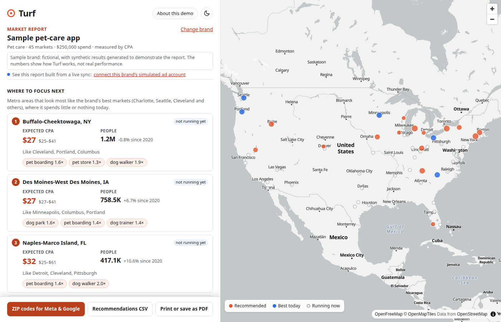
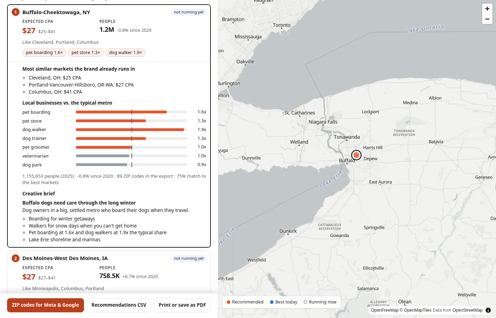
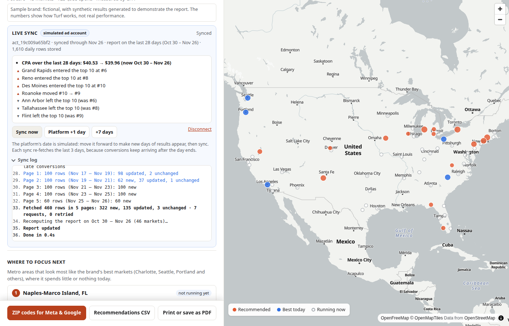

# Turf

> **A brand's ad results in, a market report out: where its ads should run next, what to expect there, and the data behind each recommendation.**

**Live demo:** https://turf.dunkasaur.gg (open a sample brand for a full report in one click, or connect a sample ad account to watch Turf sync it live and update the report)



## What it does

An agency like Valid holds ad results for every client, by location. Turf turns those results into a report a strategist can hand to the client:

1. **Where to focus next:** the metro areas that look most like the brand's best markets, where it spends little or nothing today. Each comes with an **expected result** taken from the brand's own most similar markets ("expected CPA about $27, from Cleveland, Portland and Columbus") and a plain-language snapshot of the area.
2. **How much to trust it:** whether the patterns behind the recommendations actually predicted this brand's results (high, medium or low confidence, with the numbers).
3. **What drives the brand's results:** for example, "the best markets have 1.4× the typical share of pet boarding, and more of it goes with better results".
4. **The brand's markets today:** best and worst performers, and every market in the data.
5. **The data behind each recommendation:** the most similar markets the brand already runs in and their results, the area's local businesses against the typical metro, population and growth, and a creative brief.
6. **Exports:** ZIP lists for Meta and Google Ads, a CSV of the recommendations, and a print layout that saves as a PDF.

**Input:** upload an ad-platform report by location (a ZIP or market column, spend, and conversions or revenue; Meta and Google column names work) and say what kind of brand it is. Or open one of four sample brands, or **connect a sample ad account** and watch Turf sync it live (below).



## About the demo

The live site opens with a short notice saying the same thing:
- **Sample brands are fictional**, and their results are synthetic, generated to show how the report works.
- **No real ad accounts.** A production version would connect to the brand's ad accounts. Here an uploaded CSV is read in the browser, used for one report, and never stored; or you can connect a *simulated* ad account (a stand-in platform inside the demo), which Turf syncs the way it would a real one.
- **No real-time AI generation.** The creative briefs for the sample brands' recommendations were written ahead of time, so the public demo costs nothing to run however much it's used. Everything else is calculated from data on request.
- **The data is real and public:** Overture Maps places and US Census metro areas and population.

## Why this

<!-- Draft: rewrite in your own words. -->
Valid's clients are national consumer brands (subscription apps, DTC, health and fitness, home services) buying Meta, TikTok and Google by geography. A recurring question is *where should the budget go next?* Valid already has the best possible input to answer it: each client's results by market. Overture adds what those results can't show on their own, a description of every US metro by the local businesses in it. Turf finds the metros that look like a brand's best markets, and checks whether that resemblance has actually predicted the brand's results before recommending anything.

I got here in steps. The first version was a geo-conquesting tool (ads around competitors' stores), which suits businesses with storefronts, and almost none of Valid's clients have them. A second version was a configurable market explorer with too many controls. This one does one thing: brand data in, report out.

## Decisions and trade-offs

**Method:**
- **Metros are described by their mix of local businesses**: each kind of business's share of the metro's open places. Not per-capita counts: Overture's coverage varies 3× between metros (2,100 to 6,200 open places per 100k people), so per-capita counts would partly measure how well a city is mapped.
- **Recommendations are anchored to the brand's own results.** The best markets (by ROAS or CPA, among metros with at least 1% of spend) define what "good" looks like for this brand, rather than a universal score I'd have no way to validate.
- **Every claim is checked before it's used.** Turf measures how well the business patterns predict the brand's results in markets they weren't fitted on (leave-one-out rank correlation), against 999 shufflings of the same data. The shuffling matters: the raw score is biased upward (even random results score about +0.3), and an earlier version without it gave a "moderate" verdict to a sample I had generated with no relationship at all. Patterns that don't track results get no weight, and a low-confidence report says so plainly.
- **Expected results come from the brand's own data**: the median and range of its three most similar existing markets. That makes the expectation easy to check, and honest about the spread.
- **Export ZIP codes.** Neither Meta nor Google targets Census metro areas; both take US ZIP lists.

**Product:**
- **One question before the report**: what kind of brand it is, which picks the kinds of local business to compare. Detecting it automatically would mean trying every category and keeping the best fit, which inflates the confidence numbers; a strategist already knows. The signals can still be adjusted inside the report.
- **Sample brands are fictional and labelled synthetic.** Real companies' results by metro aren't public, and invented numbers under a real name would misrepresent it. Their results are generated from the business patterns plus noise, so three samples show what a high-confidence report looks like, and one has no real relationship, to show a low-confidence one. They demonstrate the report, not the method.
- **Uploaded results are never stored**: they're client-confidential, so there are no accounts and nothing to secure at rest.
- **Briefs are pre-written** for the 20 recommendations the sample brands show, from each metro's numbers, by Claude in my Claude Code session. Their "based on" lines are generated from the data, never typed. A production version would generate briefs on demand with an API key, cache them per brand and metro, and cap daily spend (about 1–3¢ per brief at current prices).

**Data quality: the pipeline that makes the profiles trustworthy:**
- **Duplicates.** The same store often appears twice from different sources ("9500 S IH 35" vs. "9500 S Interstate 35", 518 m apart). They're flagged by street number and name within 1 km, so a business isn't counted twice in its metro.
- **"Open" means recently seen.** 18% of chain locations have no recent activity signal in Overture; only open places count.
- **Metros and population come from the Census**, pinned by SHA-256, since Overture has neither.

**Engineering:**
- **Precompute offline, serve aggregates.** The served database is 5.5 MB of per-metro counts built from 18 million places. A full report takes about 0.15 s, including the 999-shuffle check.
- **An ad-account connector, against a simulated platform.** There's no real ad account to connect, so the app includes a stand-in ad platform (`/mock/ads`, an insights API shaped like Meta's) that misbehaves the way real ones do: it refuses requests with 429s and `Retry-After`, has transient 503s, expires tokens, pages with opaque cursors, and keeps adding conversions to the last three days. The connector handles each: token refresh, retries with backoff, idempotent upserts keyed by day and market, incremental syncs that re-fetch a lookback window, and a report recomputed and compared with the previous one ("Raleigh moved from #6 to #3"). Jobs run in the background, their progress streams to the page over server-sent events, and their state lives in SQLite so either of the two workers can serve it. It costs nothing to run: no API keys, no external calls.
- **MCP server in the same app.** Valid gives each client an MCP server to query its account in plain English. Turf's analysis is available the same way at `/mcp`, including `recommend_from_results` for an agent holding a brand's ad report.
- **No-build frontend.** Plain JavaScript and MapLibre, served by the same container. Light and dark themes, a print layout, axe-checked for accessibility.
- **CI/CD:** every merge to `main` runs lint, strict typing and 145 tests. It then builds an immutable Docker image and deploys it over SSH with a key that can *only* run `deploy <sha>`. The server health-checks the new version and rolls back on failure. CI then drives the live site in a real browser, with an accessibility check.



**Not built (yet):**
- Connections to real ad accounts (the connector syncs the simulated platform; pointing it at a real one means OAuth with that platform and its field names).
- Measured demand: demographics, income, search volume.
- On-demand AI briefs and personas for uploaded brands.
- Countries other than the US.

## Use it from an AI agent (MCP)

```bash
# Claude Code
claude mcp add --transport http turf https://turf.dunkasaur.gg/mcp
```

Then ask, for example: *"Here's our ad report by market; using turf, where should we expand next and why?"*

The tools are `recommend_from_results`, `rank_markets`, `list_presets`, `search_metros`, `search_signals`, `metro_zip_codes` and `get_brief`.

## Repo

- **How it works:** a Python + DuckDB pipeline (`scripts/`, logic in `src/turf_app/`) turns a pinned Overture release and Census files into `turf.duckdb`. FastAPI (`src/turf_app/api.py`) serves the report API, the MCP tools and the page (`src/turf_app/web/`).
- **Developer docs:** [High-level design](documents/HLD.md) · [Low-level design](documents/LLD.md) · [Code guide](documents/CODE_GUIDE.md)

```bash
uv sync && uv run pytest -q
# Rebuild the data for one Overture release (about 5 minutes; see documents/LLD.md §1)
R=2026-11-18.0
uv run python scripts/extract_us.py --release $R
uv run python scripts/extract_states.py --release $R
uv run python scripts/extract_metros.py --release $R    # Census metros + population
uv run python scripts/build_chains.py --release $R      # duplicates, states
uv run python scripts/build_serving_db.py --release $R
TURF_DB=data/$R/turf.duckdb uv run uvicorn turf_app.api:app --reload
```
