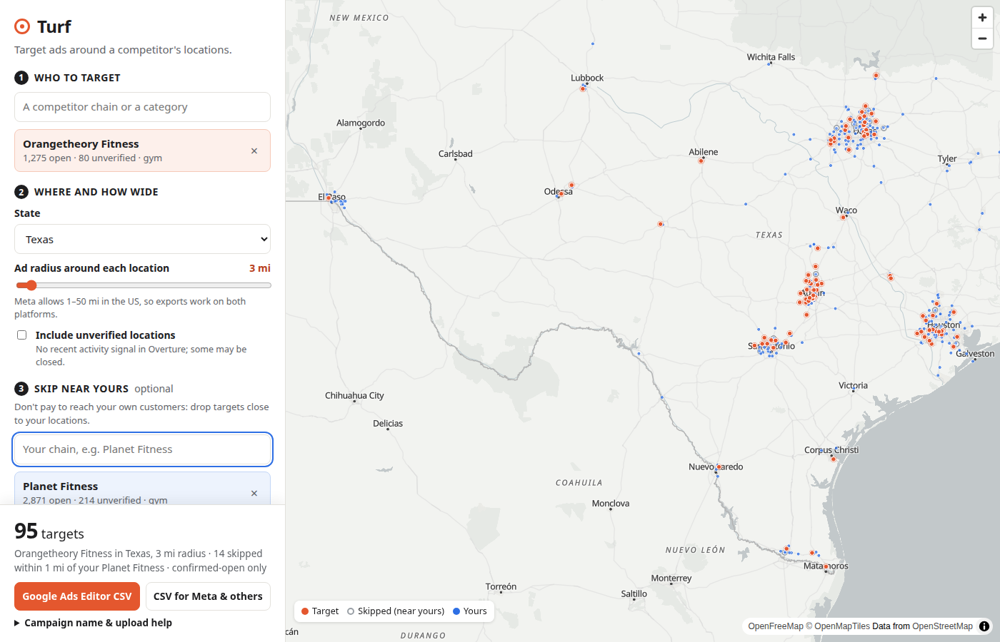
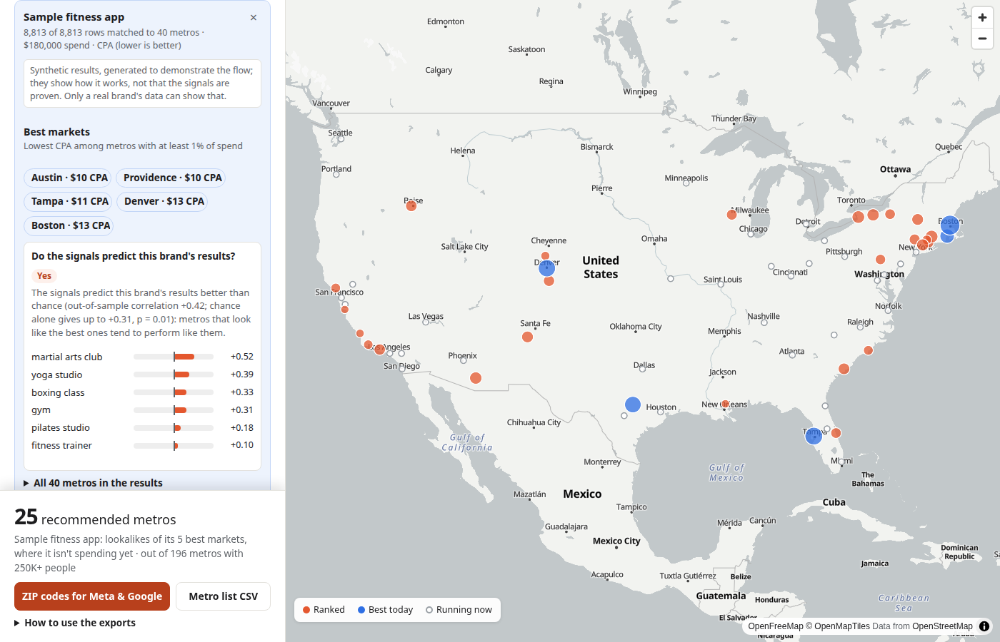

# Turf

> **Find the next US metros for a consumer brand's ad spend: places that look like its best markets, from open Overture Maps places data and Census population.**

**Live:** https://turf.dunkasaur.gg





## Who it's for

Media buyers at an AI-native agency like Valid, whose clients are national consumer brands: subscription apps, DTC, health & fitness, home services. These brands buy Meta, TikTok and Google by geography, and one recurring question is **"we do well in Denver and Austin; where else looks like that?"**

**Try it in one click:** the sample brands at the top of the page (pet-care app, fitness app, home-services brand, DTC beauty brand) are fictional, with synthetic results, and run the whole flow below.

**How to use it:**
1. **Pick an audience.** Six presets match Valid's verticals (pet care, fitness, home services, beauty & wellness, young professionals, families). Each is a set of *signals*: kinds of local business whose density hints at that audience. Edit them freely.
2. **Give it the brand's results:** upload an ad report (spend and conversions or revenue by ZIP or market, e.g. a Meta or Google Ads geo export). Turf picks the best markets by ROAS or CPA, **checks whether the signals actually predict this brand's results**, and recommends lookalikes where the brand isn't spending yet. The file is read in the browser and never stored. (Or just type a few best markets.)
3. Turf ranks every US metro area by how closely it matches them, or by signal strength without seeds. Every result says why ("dog walkers: 3.2× the typical metro's share of businesses").
4. **Open a metro** to see each signal against the typical metro and a creative brief for that market.
5. **Export** the ZIP codes for Meta or Google Ads, or the ranked metro list for a media plan.

Every view is a shareable link. AI agents can run the same search through Turf's **MCP server** (below).

## Why this

<!-- Draft: rewrite in your own words. -->
I first built Turf as a geo-conquesting tool: target lists of competitors' store locations near your own. It worked, but when I looked at who Valid's clients actually are, almost none have physical locations, so a store-conquesting tool solved a problem they don't have. What they do have is national budgets they split by geography. So I kept the data pipeline and the engineering and rebuilt the product around picking markets.

Overture is good at describing *what a place is like*: every business, what kind it is, for the whole US. That turns out to be a useful fingerprint of a metro. And unlike a universal "opportunity score", which I'd have no way to validate, lookalikes are anchored to the one thing a brand knows for sure: where it already wins.

## Decisions and trade-offs

**Product:**
- **Signals are shares of local businesses, not per-capita counts.** Overture's coverage varies 3× between metros (2,100 to 6,200 open places per 100k people), so per-capita counts would partly measure how well a city is mapped. A category's share of a metro's businesses cancels that out.
- **Every result explains itself.** A media buyer has to defend a plan to a client, so "2.1× the typical share of pet groomers" beats an opaque score.
- **It's a proxy, so it checks itself against the brand's results.** Business mix suggests where an audience lives; it doesn't measure demand. With a brand's results uploaded, Turf measures how well the signals predict a metro they weren't fitted on (leave-one-out rank correlation), and judges that against 999 shufflings of the same results. The shuffling matters: the raw number is biased upward (even random results score around +0.3), and an earlier version without it called a brand with no real relationship "moderate". Signals that don't track results are dropped from the recommendations, and a "no evidence" verdict says so plainly.
- **Sample brands are fictional and labelled synthetic.** Real companies' results by metro aren't public, and invented numbers next to a real brand's name would misrepresent it. The samples' results are generated from the signals plus noise, so their good verdicts demonstrate the flow, not the method; one sample has no real relationship, to show what "no evidence" looks like.
- **Uploaded results are never stored.** They're client-confidential, so they're parsed in the browser, sent with the request, and gone after it: no accounts, nothing to secure at rest.
- **Metros and population come from the Census, not Overture.** Overture has neither. Both files are pinned by SHA-256.
- **Export ZIP codes, not metro names.** Neither Meta nor Google targets Census metro areas, but both accept US ZIP lists. Each ZIP goes to the metro holding most of its places.

**Briefs: pre-written, so the demo costs nothing.** Each metro's creative brief would naturally come from an LLM call. But this is a take-home, and a public demo that calls a paid API on every click could run up a bill for anyone who finds it. So the 65 briefs shipped here were written ahead of time, by Claude in my Claude Code session, from each metro's actual numbers:
- **Which metros:** each preset's top 10, plus the demo path's top lookalikes.
- **Grounding:** the "Based on" lines are generated from the data, never typed.
- **Elsewhere:** metros without a brief show a note saying so.

A production version would generate briefs on demand with an API key, cache them per preset and metro, and cap daily spend (on the order of 1–3¢ per brief at current prices).

**Data quality: still the real work.** The pipeline from v1 carries over, because the same problems would distort metro profiles:
- **Duplicates.** The same store often appears twice from different sources ("9500 S IH 35" vs. "9500 S Interstate 35", 518 m apart). They're flagged by street number and name within 1 km, so a business isn't counted twice in its metro.
- **"Open" means recently seen.** 18% of chain locations have no recent activity signal in Overture. Only open places count toward signals.
- **Brand tags were missing or wrong on many places.** Chain matching fixes them, and duplicate detection depends on it.

**Engineering:**
- **Precompute offline, serve aggregates.** The served database is 5.5 MB of per-metro counts (it was 1.37 GB when it held every place). Queries take milliseconds and there's no database server.
- **MCP server in the same app.** Valid gives each client an MCP server to query its account in plain English; Turf's search is available the same way, as six read-only tools at `/mcp`.
- **No-build frontend.** Plain JavaScript and MapLibre, served by the same container: one deploy. Light and dark themes, axe-checked for accessibility.
- **CI/CD:** every merge to `main` runs lint, strict typing and 127 tests. It then builds an immutable Docker image and deploys it over SSH with a key that can *only* run `deploy <sha>`. The server health-checks the new version and rolls back automatically on failure. CI then drives the live site in a real browser, with an axe-core accessibility check.

**Not built (yet):**
- Measured demand: demographics, income, search volume.
- Pushing targets straight into ad accounts through the platforms' APIs.
- Saved plans and accounts.
- Countries other than the US.

## Use it from an AI agent (MCP)

```bash
# Claude Code
claude mcp add --transport http turf https://turf.dunkasaur.gg/mcp
```

Then ask, for example: *"Using turf, find metros like Denver and Austin for a pet-care app, and get the ZIP codes for the top three."* An agent holding a brand's ad report can call `recommend_from_results` with the rows directly.

The tools are `list_presets`, `search_metros`, `search_signals`, `rank_markets`, `recommend_from_results`, `metro_zip_codes` and `get_brief`.

## Repo

- **How it works:** a Python + DuckDB pipeline (`scripts/`, logic in `src/turf_app/`) turns a pinned Overture release and Census files into `turf.duckdb`. FastAPI (`src/turf_app/api.py`) serves the API, the MCP tools and the page (`src/turf_app/web/`).
- **Developer docs:** [High-level design](documents/HLD.md) · [Low-level design](documents/LLD.md) · [Code guide](documents/CODE_GUIDE.md)

```bash
uv sync && uv run pytest -q
# Rebuild the data for one Overture release (about 5 minutes; see documents/LLD.md §1)
R=2026-11-18.0
uv run python scripts/extract_us.py --release $R
uv run python scripts/extract_states.py --release $R
uv run python scripts/extract_metros.py --release $R    # Census metros + population
uv run python scripts/build_chains.py --release $R      # duplicates, states
uv run python scripts/build_serving_db.py --release $R
TURF_DB=data/$R/turf.duckdb uv run uvicorn turf_app.api:app --reload
```
